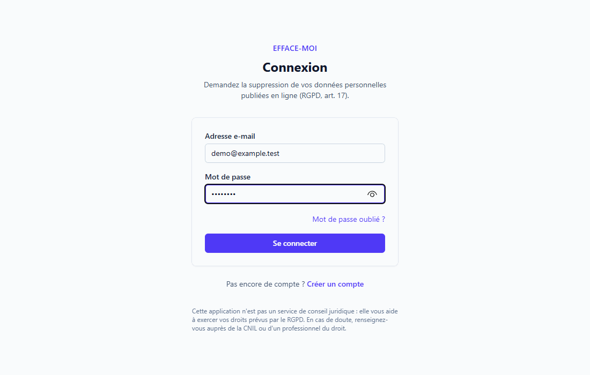

# Efface-moi — exercer son droit à l'effacement (RGPD)

[](https://github.com/mohamed-ali-akir/rgpd-app/actions/workflows/ci.yml)

Application web full stack qui aide une personne à obtenir la suppression de ses données personnelles publiées en ligne :
elle colle l'adresse de la page, l'application identifie l'organisme responsable, génère une demande d'effacement
(art. 17) et d'opposition (art. 21), l'envoie depuis son Gmail ou l'aide à l'envoyer elle-même, suit le délai légal
d'un mois (art. 12.3) et prépare si besoin un dossier de plainte pour la CNIL (art. 77).

> ⚠️ **Ce n'est pas un service de conseil juridique.** L'application aide à exercer des droits prévus par le RGPD à partir
> de règles générales ; l'utilisateur reste responsable du contenu de sa demande, qu'il peut modifier avant l'envoi.

Projet réalisé dans le cadre du BTS SIO option SLAM (épreuve E6).



## Fonctionnalités (V1)

- Inscription, connexion (Laravel Sanctum en mode SPA), vérification de l'adresse e-mail, mot de passe oublié
- Assistant en 4 étapes : URL → organisme (détecté, recherché ou créé) → données concernées → lettre modifiable
- Fondements juridiques suggérés et avertissements (registres légaux, presse, moteurs de recherche) par des **règles fixes, sans IA**
- Envoi depuis le Gmail de l'utilisateur (scope `gmail.send` uniquement) **ou** envoi manuel puis confirmation
- Suivi du délai légal : 1 mois, prolongeable de 2 mois ; passage automatique en « délai dépassé » chaque jour et notification
- Relance, saisie de la réponse reçue, dossier de plainte CNIL en PDF
- Historique horodaté de chaque demande (jamais modifié)
- Export de ses données (JSON), suppression du compte en cascade, purge automatique après 12 mois

## Fonctionnalités (V2)

Le cahier des charges complet est dans [docs/V2.md](docs/V2.md).

- **Scanner « Mes données en ligne »** : recherche du nom, de l'e-mail et du téléphone du titulaire du compte dans le
  registre des entreprises (API publique Recherche d'entreprises, gratuite, sans clé) et sur le web (via une instance
  [SearXNG](https://docs.searxng.org)). Les pages trouvées sont relues pour confirmer la présence des données, avec un
  score de confiance. L'utilisateur confirme chaque résultat (homonymes), et les résultats confirmés deviennent des brouillons
  en un clic. Rien n'est envoyé automatiquement. Une recherche mensuelle automatique est disponible sur option.
- **Vérifications guidées** pour les sites qui refusent la lecture automatique (réseaux sociaux…) : un lien de recherche par site.
- **Vérification de l'effacement** : après une réponse positive, l'application relit la page (après 3 jours, puis toutes
  les semaines) et signale si les données sont toujours en ligne, avec relance ou plainte possible.
- **Autres droits** : accès (art. 15), rectification (art. 16) et limitation (art. 18), avec leurs propres lettres.
- **Mode démo** (`APP_DEMO=true`) : compte partagé et données fictives, aucun e-mail ni recherche réelle, inscription et
  Gmail désactivés, réinitialisation chaque nuit.
- **Lecture web sécurisée** : protection SSRF (IP publiques uniquement, IP figée contre le DNS rebinding, redirections
  vérifiées une à une), respect de robots.txt, taille et durée limitées.

## Stack

| Couche | Choix |
|---|---|
| Front | React 19, TypeScript, Vite, React Router, TanStack Query, react-hook-form + zod, Tailwind CSS |
| Back | Laravel 13 (API REST), Sanctum (SPA : cookies + CSRF), Socialite (OAuth Google), dompdf |
| Données | MySQL en production, SQLite en développement et en mémoire pour les tests |
| Asynchrone | File d'attente Laravel (driver `database`), planificateur Laravel (cron) |
| Tests | Pest (back, 279 tests), Vitest + React Testing Library (front, 41 tests) ; aucun test n'accède au réseau |
| Qualité | Larastan (PHPStan niveau 6), Pint, ESLint, TypeScript strict |
| CI | GitHub Actions : Pint, Larastan, Pest (SQLite et MySQL 8.4), tsc, ESLint, Vitest, build Vite |

## Architecture

```
navigateur ──► Nginx (un seul domaine)
                ├── /              → build React (frontend/dist)
                └── /api, /sanctum → Laravel (backend/public/index.php)
                                       ├── contrôleurs → services métier → modèles Eloquent → MySQL
                                       └── jobs (envoi Gmail, scan, vérification) → table "jobs" ← worker (queue:work)
cron (chaque minute) → schedule:run → requests:check-deadlines (8 h), requests:verify-erasures (9 h),
                                      scans:run-scheduled (10 h), model:prune, demo:reset (3 h, démo seulement)
```

- **Dépendances externes derrière des interfaces** (`MailSender`, `SearchProvider`, `ScanSource`, `HostResolver`) :
  chaque implémentation réelle a un double « fake » pour les tests et la démo, et se choisit dans `AppServiceProvider`.

- **Monorepo** : `backend/` (Laravel) et `frontend/` (React).
- **Même domaine** pour le SPA et l'API : condition pour que le cookie de session Sanctum soit envoyé.
- **Toute la logique métier est dans le back** (machine à états, règles juridiques, délais, actions possibles) :
  le front affiche les boutons que l'API lui indique (`available_actions`).
- **Machine à états** : `RequestStatus::allowedTransitions()` ; tout changement de statut passe par
  `ErasureRequest::transitionTo()`, qui vérifie la transition et écrit l'événement d'historique dans la même transaction.

Le guide détaillé, fichier par fichier, est dans [docs/GUIDE.md](docs/GUIDE.md).

## Installation en développement

Prérequis : PHP 8.4 + Composer (par exemple via [Laravel Herd](https://herd.laravel.com)), Node.js 22+.

Les commandes sont à lancer depuis la racine du projet (`rgpd-app`). Elles utilisent `;` et non `&&`, que
Windows PowerShell 5.1 ne reconnaît pas.

```bash
# Backend
cd backend
composer install
cp .env.example .env
php artisan key:generate
php artisan migrate --seed      # crée database/database.sqlite + organismes + compte de démo
php artisan serve               # http://127.0.0.1:8000

# Dans un 2e terminal : le worker qui exécute les envois Gmail, les scans et les vérifications
cd backend; php artisan queue:work --timeout=650

# Dans un 3e terminal : le front
cd frontend
npm install
npm run dev                     # http://localhost:5173 (ouvrir cette adresse)
```

Ouvrez **http://localhost:5173** (et non le port 8000) : le serveur Vite transmet `/api` et `/sanctum` à Laravel,
le front et l'API sont donc sur le même domaine, comme en production.

Compte de démonstration (créé par le seeder en local) : `demo@example.test`, mot de passe `password`.

En développement, les e-mails de l'application (vérification, alertes de délai) sont écrits dans
`backend/storage/logs/laravel.log` (`MAIL_MAILER=log`), et `MAIL_SENDER=fake` fait que **rien n'est envoyé à Gmail**.

### Tests

```bash
cd backend; vendor/bin/pest           # 279 tests
cd backend; vendor/bin/phpstan analyse --memory-limit=1G
cd frontend; npm test                 # 41 tests
cd frontend; npm run typecheck; npm run lint; npm run build
```

### Simuler un délai dépassé

```bash
cd backend; php artisan requests:check-deadlines
```

## Configurer Gmail (OAuth Google)

1. [Google Cloud Console](https://console.cloud.google.com) → créer un projet.
2. « API et services » → Bibliothèque → activer **Gmail API**.
3. « Écran de consentement OAuth » → type **Externe** ; ajouter le seul scope
   `https://www.googleapis.com/auth/gmail.send` (scope « sensible »).
4. **Passer l'application en « En production »** sans demander la validation Google. En mode « Test », Google
   invalide les refresh tokens au bout de 7 jours, ce qui casserait les relances (envoyées au bout d'un mois).
   En production non validée, les utilisateurs voient un écran « application non validée » et l'application est
   limitée à 100 utilisateurs, ce qui suffit pour un projet de portfolio.
5. « Identifiants » → ID client OAuth de type **Application Web**, URI de redirection autorisée :
   `http://localhost:5173/api/auth/google/callback` (et l'équivalent `https://` en production).
6. Dans `backend/.env` : `GOOGLE_CLIENT_ID`, `GOOGLE_CLIENT_SECRET`, puis `MAIL_SENDER=gmail`.

Si un utilisateur retire l'accès, l'envoi échoue proprement : l'événement « Échec de l'envoi » s'affiche, la connexion
Gmail est supprimée et l'utilisateur est invité à la refaire (ou à passer en envoi manuel).

## Configurer la recherche web du scanner (SearXNG)

Il n'existe plus d'API gratuite de recherche sur tout le web : Google Custom Search n'accepte plus de nouveaux clients,
l'API Bing a fermé, et Brave exige une carte bancaire. Le scanner passe donc par **SearXNG**, un métamoteur libre qu'on
héberge soi-même (gratuit). Il est derrière l'interface `SearchProvider`, ce qui permet de changer de moteur sans toucher au scanner.

| `SEARCH_PROVIDER` | Effet |
|---|---|
| `none` (défaut) | Pas de recherche web : le scanner n'interroge que le registre des entreprises, et le rapport indique « non configurée » |
| `searxng` | Requêtes vers `SEARXNG_URL` (format JSON à activer dans la configuration de SearXNG) |
| `fake` | Résultats fictifs, pour le développement |

L'installation par Docker est décrite dans [deploy/README.md](deploy/README.md#7-recherche-web-searxng-facultatif).

## Mode démo

Avec `APP_DEMO=true` :
- la page de connexion affiche les identifiants de démo (`demo@example.test` / `demo-efface-moi`) et un bouton « Essayer la démo » ;
- un bandeau rappelle que tout est fictif ;
- les envois passent par `FakeSender` : aucun e-mail ne part ;
- le scanner n'utilise que des résultats fictifs, sans aucun accès réseau ;
- l'inscription, le mot de passe oublié, la connexion Gmail et la suppression du compte sont désactivés (middleware `not-in-demo`) ;
- `demo:reset` remet chaque nuit à 3 h des demandes à chaque étape et des résultats à examiner.

En local : `php artisan demo:reset --force` crée ces données sans activer le mode démo.

## Mise en production

Le guide pas à pas (VPS Ubuntu, Nginx, PHP-FPM, MySQL, HTTPS, worker, cron, sauvegardes) est dans
[deploy/README.md](deploy/README.md), avec le modèle [backend/.env.production.example](backend/.env.production.example).
En résumé :

- Nginx : voir [deploy/nginx.conf](deploy/nginx.conf) (SPA à la racine, `/api` et `/sanctum` vers PHP-FPM).
- `.env` de production : `APP_ENV=production`, `APP_DEBUG=false`, `APP_URL=https://votre-domaine`,
  `SANCTUM_STATEFUL_DOMAINS=votre-domaine`, `SESSION_SECURE_COOKIE=true`, `DB_CONNECTION=mysql` (+ identifiants),
  un vrai SMTP pour les e-mails de l'application, `MAIL_SENDER=gmail`.
- `php artisan migrate --force` puis `php artisan db:seed --class=OrganizationSeeder --force`.
- Worker permanent (systemd ou Supervisor) : `php artisan queue:work --tries=3 --timeout=650` (un scan peut durer
  jusqu'à 10 minutes ; `DB_QUEUE_RETRY_AFTER=700` doit rester supérieur à ce délai, un test le vérifie).
- Recherche web : `SEARCH_PROVIDER=searxng` et `SEARXNG_URL` (voir ci-dessous). Sans cela, le scanner n'utilise que le registre des entreprises.
- Cron : `* * * * * cd /var/www/rgpd-app/backend && php artisan schedule:run >> /dev/null 2>&1`.
- Front : `cd frontend && npm ci && npm run build` (Nginx sert `frontend/dist`).

## Contacts des organismes : vérification manuelle obligatoire

`backend/database/seeders/OrganizationSeeder.php` contient une trentaine de sites français (nom, domaine, catégorie)
**sans aucun contact** : aucune adresse de DPO ni URL de formulaire n'a été inventée. Pour chaque organisme, relever
le contact sur sa politique de confidentialité officielle, le renseigner dans le seeder avec la date de vérification
(`'verified' => 'AAAA-MM-JJ'`), puis relancer le seeder. Tant qu'un organisme n'est pas vérifié, l'application
affiche « coordonnées non vérifiées » et propose l'envoi manuel.

Un point de départ pour cette vérification, avec les sources et un niveau de confiance pour chaque contact, se
trouve dans [docs/contacts-a-verifier.md](docs/contacts-a-verifier.md).

## Ce que nous faisons de vos données (privacy by design)

L'application applique à ses propres utilisateurs les principes qu'elle les aide à faire respecter :

- **Minimisation** : seuls le nom et le prénom sont obligatoires (pour signer les lettres) ; adresse et téléphone sont facultatifs.
- **Chiffrement** : profil (nom, prénom, adresse, téléphone) et jeton Google chiffrés en base (cast `encrypted`, clé `APP_KEY`).
- **Accès Gmail minimal** : scope `gmail.send` uniquement, l'application ne peut pas lire la boîte de réception ; la
  réponse de l'organisme est saisie par l'utilisateur.
- **Pas de jeton dans le navigateur** : session par cookie `HttpOnly` + protection CSRF (Sanctum SPA), rien dans `localStorage`.
- **Effacement** : la suppression du compte supprime en cascade profil, demandes, historique et compte Google, et révoque
  le jeton chez Google.
- **Accès et portabilité** : export JSON de toutes ses données (art. 15 et 20).
- **Conservation limitée** : demandes clôturées supprimées automatiquement 12 mois après leur clôture ; jetons de
  réinitialisation du mot de passe expirés purgés chaque jour (`auth:clear-resets`).
- **Pas de données personnelles dans les journaux** : les messages d'erreur et les sorties de commandes n'en contiennent
  pas, et la file d'attente ne stocke que l'identifiant de la demande.
- **Scanner limité au titulaire du compte** : on ne peut chercher que l'identité de son propre profil (pas de champ libre),
  avec un e-mail vérifié et 4 recherches par mois au maximum. Titres et extraits des résultats sont chiffrés, et les
  résultats écartés sont supprimés 6 mois après la décision.
- Une page « Ce que nous faisons de vos données » est accessible dans l'application.

## Choix techniques et écarts au cahier des charges

| Sujet | Décision | Raison |
|---|---|---|
| Version de Laravel | 13 au lieu de 12 | Laravel 12 ne reçoit plus que des correctifs de sécurité depuis août 2026 |
| Lint du front | ESLint (le modèle Vite propose désormais oxlint) | Conforme au cahier des charges |
| Routes OAuth et téléchargements | Déclarées dans `routes/web.php` sous `/api` | Au retour de Google, la requête vient d'un autre site : Sanctum n'activerait pas la session sur une route d'API |
| Autorisations | Middleware `can:` sur les routes plutôt que `$this->authorize()` | La Policy s'exécute avant la validation : la demande d'un autre utilisateur renvoie toujours 403 |
| Événement `send_failed` | Ajouté à `EventType` | L'utilisateur doit voir qu'un envoi Gmail a échoué |
| Route `POST /requests/{id}/close` | Ajoutée | Permet d'atteindre le statut `closed` (et donc la purge à 12 mois) |
| `mark-sent` | Accepte une date d'envoi passée | Un courrier peut avoir été posté avant la saisie |
| Avertissement `unverified_contact` | Ajouté à LegalAdvisor | Les contacts du seeder doivent être vérifiés à la main |
| Profil créé à l'inscription | Prénom et nom demandés à l'inscription | Les lettres en ont besoin dès la première demande |
| Mot de passe oublié | Ajouté (`POST /api/forgot-password`, `POST /api/reset-password`) | Indispensable pour une vraie mise en ligne |
| Nom de l'application | « Efface-moi » (provisoire) | À remplacer librement (`APP_NAME`, `index.html`) |
| Recherche web (V2) | SearXNG auto-hébergé | Seule solution gratuite et durable (voir plus haut) |
| Réseaux sociaux (V2) | Vérifications guidées plutôt que lecture automatique | Ces sites interdisent les robots (robots.txt, conditions d'utilisation) |
| Pages front (V2) | Chargées à la demande (`React.lazy`) | Le premier chargement passe sous la barre des 500 kB |

## Limites connues

- Les organismes ajoutés par un utilisateur sont visibles par tous : un contact erroné pourrait être réutilisé
  (ils sont signalés « Ajouté par un utilisateur » ; une modération serait nécessaire à plus grande échelle).
- Le scanner ne voit que ce que le registre des entreprises et SearXNG indexent : un résultat absent ne prouve pas que
  les données ne sont publiées nulle part. Les homonymes restent possibles, d'où la confirmation manuelle.
- La vérification de l'effacement compare le texte de la page : une donnée affichée en image ou chargée en JavaScript
  n'est pas détectée (le résultat est alors « absent » ; l'utilisateur garde la main).
